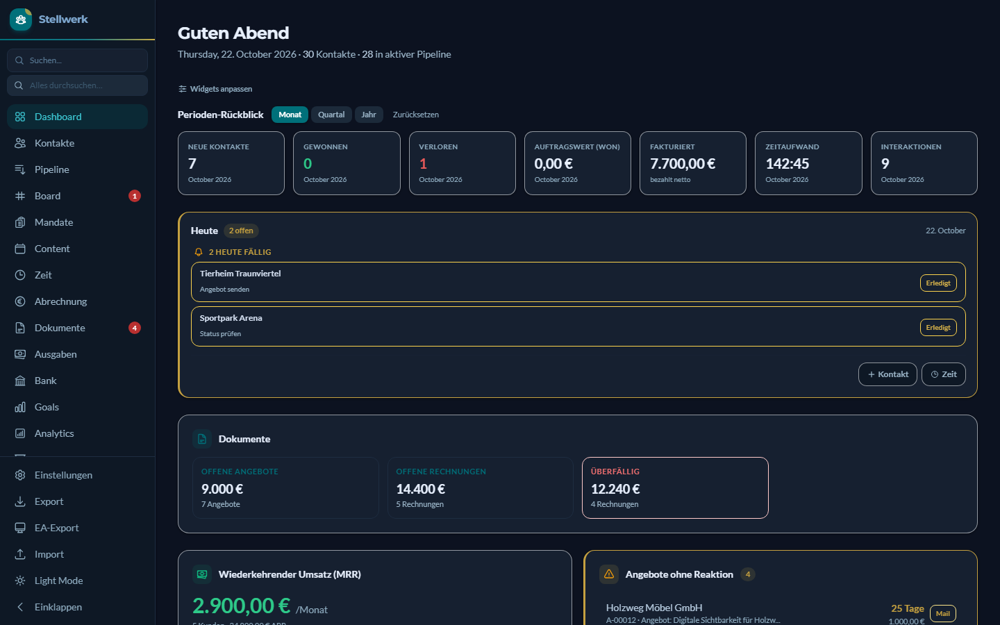
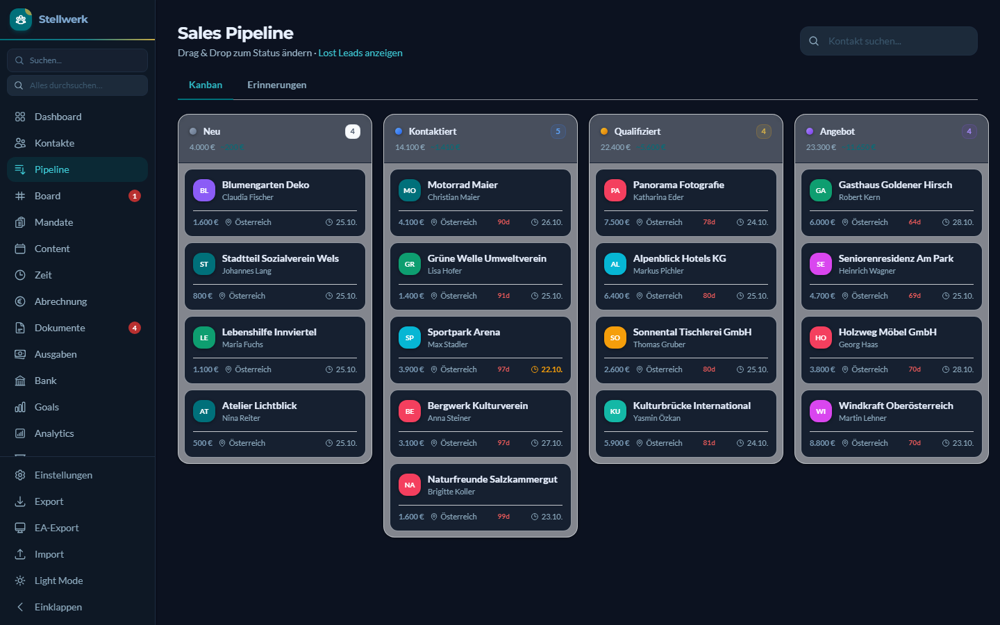
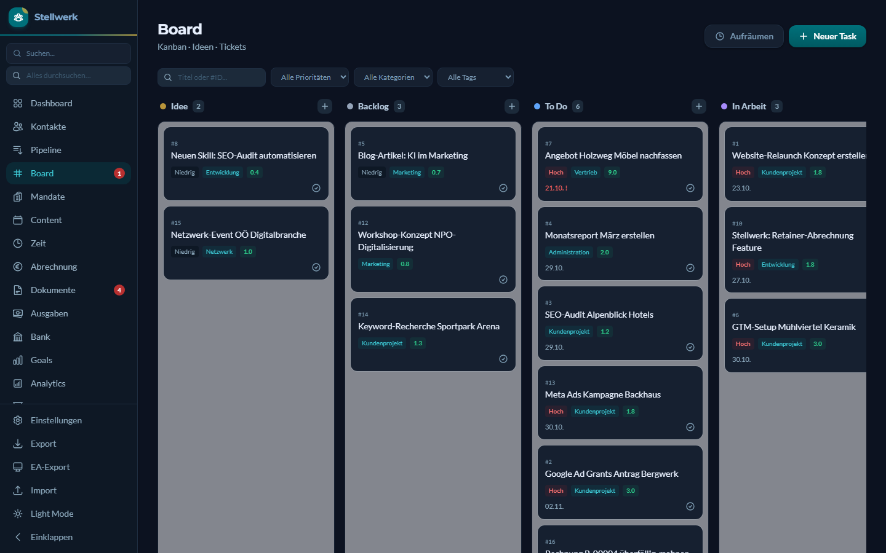
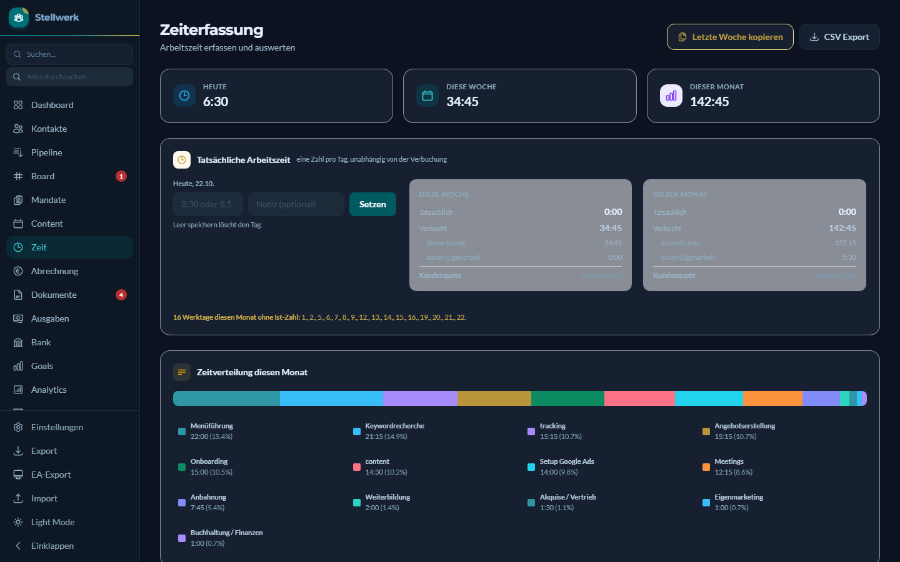

# Stellwerk

[English](README.md) · **Deutsch**

**Das Stellwerk: die Leitstelle eines Ein-Personen-Betriebs.**

Das Operations-Backend einer Ein-Personen-Beratung: Kontakte und Pipeline, Angebote und Rechnungen, Zeiterfassung, Aufgaben-Board, Retainer-Abrechnung, Bank-Abgleich und die Vorstufe zur Einnahmen-Ausgaben-Rechnung. Eine Flask-App mit SQLite, lokal betrieben.

Der Unterschied zu einem gewöhnlichen CRM liegt in der Bedienung. Das Stellwerk ist dafür gebaut, dass ein KI-Assistent damit arbeitet. Ein MCP-Server gibt Claude Zugriff auf Aufgaben und Zeiteinträge, und jeder Schreibzugriff von Claude läuft über eine eigene Schreib-Schicht (`stellwerk_write.py`) mit Validierung und festen WHERE-Klauseln. Ab Werk liefert jedes Werkzeug nur eine Vorschau, gespeichert wird, wenn der Aufruf mit `commit=True` wiederholt wird. Das ist eine Konvention der Werkzeuge, kein Schloss: Ein Client, der schon beim ersten Aufruf `commit=True` mitgibt, schreibt sofort. Die Weboberfläche schreibt über ihre eigenen Routen, nicht über diese Schicht.

> **Nur lokal betreiben.** Das Stellwerk hat keinen Login und lauscht nur auf `127.0.0.1`. Die Prüfung von Herkunft und Host schützt vor fremden Webseiten im selben Browser, sie ersetzt keine Anmeldung. Wer die App in ein Netzwerk oder ins Internet stellt, gibt alle Daten frei. Der Flask-Debugger ist ab Werk aus und lässt sich mit `STELLWERK_DEBUG=1` einschalten. Er führt beliebigen Code aus, deshalb nur kurz und nur lokal.



| Pipeline | Board |
|---|---|
|  |  |



Alle Daten in den Screenshots stammen aus der Demo-Datenbank und sind erfunden.

## Wie ich damit arbeite

Ein typischer Kundenauftrag, mit dem Demo-Kunden Bergwerk Kulturverein anstelle eines echten:

1. **Nach dem Erstgespräch** sage ich Claude, was wir vereinbart haben. Claude baut das Angebot im Stellwerk, ich lese es im Browser, und die Begleitmail landet als Entwurf in meinem Mailprogramm. Absenden tue ich.
2. **Während ich arbeite**, bucht Claude die Zeit auf den Kunden. Das Werkzeug zeigt zuerst eine Vorschau, dann speichert es.
3. **Am Monatsende** bereitet Claude die Rechnung aus den gebuchten Stunden vor. Ich prüfe das PDF und versende selbst.
4. **Alles dazwischen steht im Board.** Bevor Claude an einer Aufgabe weiterarbeitet, misst es den aktuellen Stand, statt der Beschreibung zu glauben, und schreibt den Befund als Kommentar dazu.
5. **Beiträge für meine eigenen Kanäle** entstehen als Entwurf im Content-Kalender. Raus geht nichts, bevor ich es in der Feed-Vorschau freigebe.

Das Muster ist überall gleich: Claude bereitet vor und dokumentiert, ich entscheide und versende. Ein paar Zahlen aus meiner eigenen Datenbank, Stand 27. Oktober 2026:

| | |
|---|---|
| Aufgaben seit März 2026 | 1.077 |
| davon von Claude angelegt (seit Mai) | 371 |
| von mir angelegt | 460, der Rest über automatische Regeln |
| Kommentare zu Aufgaben, von Claude geschrieben | 928 von 939 |
| Social-Beiträge über den Kalender veröffentlicht | 96 seit Juli |
| Zeiteinträge | 1.198 |
| Tests im privaten Repo / in diesem | 1.093 / 280 |

Ich arbeite mit fünf Claude-Code-Profilen parallel am selben Board. Daher kommt die Gewohnheit: Ein Task-Status ist ein Zeitstempel, keine Tatsache.

Drei Entscheidungen und ihr Preis:

- **Lokal statt Cloud.** Kundendaten verlassen den Laptop nicht. Der Preis: kein Zugriff vom Handy, und die Backups sind meine Sache.
- **SQLite statt Datenbankserver.** Eine Datei, leicht zu sichern, und Claude kann sie lesend abfragen, ohne etwas zu verändern. Der Preis: ein Benutzer, kein gleichzeitiger Zugriff von mehreren Rechnern.
- **Selbst gebaut statt gekauft.** Es passt genau zu meinen Abläufen, und Claude kann es über MCP bedienen. Der Preis: Ich warte es selbst, und jede Änderung im Betrieb wird zu einer Änderung im Code.

## Für deinen Betrieb

Das Stellwerk ist für einen ganz bestimmten Betrieb gewachsen, nämlich für meinen. Wenn du dir so ein Werkzeug für deine eigenen Abläufe wünschst, eingerichtet und mit Claude verbunden, schreib mir unverbindlich an [office@digitalisierungswerkstatt.at](mailto:office@digitalisierungswerkstatt.at?subject=Stellwerk) mit dem Betreff „Stellwerk“.

## Funktionsumfang

- **Kontakte und Pipeline:** Kanban mit sieben aktiven Stufen plus „verloren“ und „keine Antwort“, Interaktions-Historie, Follow-up-Regeln, Volltextsuche (SQLite FTS5)
- **Angebote und Rechnungen:** Positionen in Gruppen, PDF über Puppeteer, Angebot zu Rechnung, Storno, dreistufiges Mahnwesen, ZUGFeRD/Factur-X
- **Zeiterfassung:** Timer, wiederkehrende Einträge, Trennung von Kundenarbeit und Eigenarbeit, tatsächliche Arbeitszeit je Tag
- **Abrechnung:** Retainer mit Stundenkontingent, True-up, Monatslauf, Profitabilität je Mandat
- **Ausgaben und Bank:** Eingangsrechnungen, N26-CSV-Import, Zuordnung von Zahlungen zu Belegen
- **Board:** Aufgaben mit Prioritäten, Tags, Kommentaren und wiederkehrenden Terminen
- **Content-Kalender:** Planung von Social-Media-Beiträgen mit Freigabestufen und Feed-Vorschau, Veröffentlichung über externe Scripts (siehe unten)

Die Oberfläche ist deutschsprachig. Die Rechnungslogik folgt österreichischem Umsatzsteuerrecht.

## Schnellstart mit Demo-Daten

Voraussetzungen: Python 3.13, Node.js 22.12 oder neuer (nur für die PDF-Erzeugung).

```bash
pip install -r requirements.txt
npm install                 # Puppeteer für PDFs
python seed_demo_data.py    # legt data/demo.db mit erfundenen Daten an
python start_demo.py        # http://localhost:5001
```

Für den eigenen Betrieb `python app.py` starten (Port 5000, Datenbank `data/crm.db`). Firmendaten, Bankverbindung und Stundensatz stehen unter Einstellungen.

Unter Windows in einen kurzen Pfad klonen, etwa `C:\stellwerk`. Das E-Rechnungs-Paket `factur-x` bringt XSD-Dateien mit sehr langen Namen mit, und ohne Unterstützung langer Pfade in Windows scheitert `pip install` in tief verschachtelten Ordnern.

### Mit Docker

```bash
docker compose up                              # Demo, http://localhost:5001
docker compose --profile echt up -d stellwerk  # eigener Betrieb, http://localhost:5000
```

Das Image bringt Chromium für die PDFs mit und läuft auf amd64 und arm64. Der eigene Betrieb legt seine Daten in `./data`, `./uploads` und `./backups` neben der Compose-Datei ab. Beide Ports sind absichtlich an `127.0.0.1` gebunden. Diese Bindung nicht durch eine einfache Portangabe ersetzen: Docker würde das Stellwerk sonst auf allen Netzwerkschnittstellen veröffentlichen, an der Firewall vorbei, und es hat keinen Login. Der Container läuft als root, und Chromium läuft ohne eigene Sandbox, wie es für PDF-Erzeugung in Containern üblich ist. Für ein lokales Werkzeug vertretbar, für einen Dienst im Netzwerk nicht.

## Mit Claude Code verbinden

```bash
claude mcp add stellwerk -- python /pfad/zum/repo/mcp_server.py
python mcp_server.py --selftest
```

Der Server stellt `task_get`, `task_create`, `task_close`, `task_comment`, `task_check` und `time_book` bereit. Alle schreibenden Werkzeuge liefern ohne `commit=True` nur eine Vorschau und berühren die Datenbank nicht.

## Was rund um den Kern läuft

In meinem Betrieb ist dieses Repo der Kern, nicht das ganze System. Drei Schichten laufen drumherum. Sie hängen an meinen Konten und Zugängen und sind deshalb hier nicht enthalten.

- **Veröffentlichen:** Freigegebene Einträge aus dem Content-Kalender gehen über eigene Scripts an Instagram, Facebook und LinkedIn, samt erstem Kommentar. Einträge mit einem Termin in der Zukunft wandern in eine Warteschlange auf dem Webserver, und GitHub Actions postet sie zum Termin, auch wenn der Laptop schläft. Die Stellwerk-Seite davon sind `content_publisher.py` und `content_outbox.py`.
- **Geplante Läufe:** fällige Beiträge veröffentlichen, den Kalender auf liegengebliebene Beiträge und fehlende Kanäle prüfen, einen wöchentlichen Kennzahlen-Bericht schreiben und beim Rechnerstart das Stellwerk samt Tages-Backup hochfahren.
- **Claude-Skills:** Arbeitsanweisungen, mit denen Claude Code die wiederkehrenden Abläufe erledigt, etwa Rechnung stellen, Angebot bauen, Eingangsrechnung erfassen, Zeit buchen und den Tagesabschluss. Der MCP-Server deckt davon den Teil ab, der Aufgaben und Zeiten betrifft.

Für einen anderen Betrieb ist genau diese Schicht die Einrichtungsarbeit, siehe [Für deinen Betrieb](#für-deinen-betrieb).

## Tests

```bash
python -m pytest tests
```

Hier liegt eine Auswahl der Tests, nämlich die, die ohne Daten aus dem echten Betrieb auskommen. Tests mit echten Beträgen, Belegnummern oder Kontoauszügen bleiben privat.

## Grenzen

- Ohne die Scripts aus dem Abschnitt oben postet der Content-Kalender nicht. `content_publisher.py` ruft `~/scripts/meta_publish.py` und `~/scripts/linkedin_publish.py` auf, `content_outbox.py` lädt `~/scripts/social_outbox.py` und braucht dazu einen GitHub-Actions-Runner samt Auslöser. Mail-Entwürfe brauchen `~/scripts/email_draft.py`. Fehlt ein Script, nennt das Stellwerk den erwarteten Pfad. Die Cloud-Warteschlange ist ab Werk aus (Einstellung `content_outbox_enabled`).
- Ein Benutzer, keine Rechteverwaltung, keine Mandantenfähigkeit.
- Beim Öffnen des Dashboards laufen einige Automatiken (Follow-up-Erinnerungen, Dokumentstatus, wiederkehrende Zeiteinträge). Weil das bei einem einfachen Seitenaufruf passiert, könnte eine fremde Webseite sie auslösen, indem sie den Browser auf `localhost` schickt. Lesen oder etwas anderes ändern kann sie nicht, aber es ist eine Nebenwirkung eines GET-Aufrufs, und man sollte davon wissen.
- Die Oberfläche lädt ihre Schriften von Google Fonts und Alpine.js sowie SortableJS von jsDelivr, mit Integritätsprüfung. Ohne Internet fällt die Schrift auf Systemschriften zurück, und die interaktiven Teile funktionieren nicht. Tailwind liegt bei.
- Zugangsdaten, die bei einem Kontakt hinterlegt werden (Bereich „Konten & Zugänge“), liegen im Klartext in der Datenbank. Die Datei `data/crm.db` und ihre Backups deshalb behandeln wie einen Passwort-Tresor ohne Schloss.
- Der Code erscheint hier ohne Kommentare. Im Original sind sie die Arbeitsnotizen des Betriebs und nennen dafür Kund*innen, Beträge und Belege. Geblieben sind nur die Beschreibungen der MCP-Werkzeuge, weil Claude sie liest.

## Haftungshinweis

Rechnungsstellung, Mahnwesen, Umsatzsteuer-Logik und Einnahmen-Ausgaben-Export bilden den Stand ab, mit dem ein österreichisches Einzelunternehmen arbeitet. Das ist keine Steuer- oder Rechtsberatung und ohne Gewähr. Vor dem produktiven Einsatz mit der eigenen Steuerberatung abstimmen.

## Status

Ein Schnappschuss eines Werkzeugs, das im eigenen Betrieb täglich läuft. Es wird hier nicht laufend gepflegt, Tickets und Pull Requests werden nicht betreut.

Rückmeldungen sind bis 10. November 2026 in den [GitHub Discussions](../../discussions) willkommen. Danach bleibt das Repo ein reiner Schnappschuss.

## Lizenz

GNU Affero General Public License v3.0, Volltext in [LICENSE](LICENSE). Wer das Stellwerk verändert und als Dienst über ein Netzwerk anbietet, muss den geänderten Quellcode den Nutzer*innen zugänglich machen.

Ausgenommen ist `static/vendor/tailwind-3.4.17.js`. Die Datei stammt unverändert von Tailwind Labs und steht unter der MIT-Lizenz, siehe [static/vendor/LICENSE-tailwindcss.txt](static/vendor/LICENSE-tailwindcss.txt).

Copyright (C) 2026 Lukas Tröls, Digitalisierungswerkstatt.at e.U.

Gebaut von Lukas Tröls, [Digitalisierungswerkstatt.at](https://digitalisierungswerkstatt.at), Oberösterreich, mit Claude Code.
